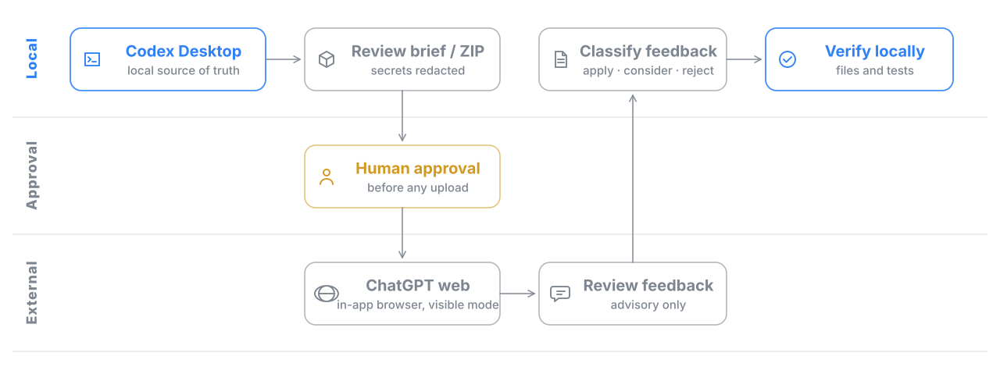

# Cross Review Bridge

This repository packages Codex skills for human-approved Pro review workflows between a local Codex Desktop workspace and ChatGPT web.

It keeps Codex Desktop as the source of truth and executor. ChatGPT web feedback is treated as advisory, then verified locally before code, document, or artifact changes are applied.

## Why

Coding agents work fast inside a local workspace, but a second opinion from a stronger reviewer catches design and correctness issues they miss. Sending project content to an external service, however, needs a human decision and a local check of whatever comes back. This plugin turns that into a repeatable, approval-gated loop.



## What It Does

- Builds compact review briefs from local project context.
- Builds richer review ZIP packages when a single upload should preserve the full Codex Desktop work context.
- Supports review, analysis, debugging, and research handoffs.
- Redacts common secret patterns before generating the brief.
- Uses the Codex Desktop in-app browser to work through ChatGPT web by default.
- Uses a human approval gate before sending project content to ChatGPT web.
- Helps Codex classify external feedback as `apply`, `consider`, `reject`, or `needs user decision`.

## Review Flow

The default transport is the Codex Desktop in-app browser, so every submission stays visible and approval-gated.

1. Codex Desktop builds a local brief.
2. For richer handoffs, Codex Desktop builds a self-contained ZIP with `000_READ_ME_FIRST.txt`, `000_REVIEW_PROMPT.md`, and `000_MANIFEST.md`.
3. Codex Desktop opens or reuses ChatGPT web in the in-app browser.
4. The user logs in manually if needed.
5. Codex selects the model mode shown in the web UI only after observing it.
6. Codex asks before submitting project content or uploading a ZIP.
7. Codex reads the visible web response and verifies it locally.


## Install In Codex Desktop

This repository is packaged as an official-style Codex plugin with a `.codex-plugin/plugin.json` manifest and a bundled `skills/` directory.

Add the marketplace once:

```powershell
codex plugin marketplace add NAMUORI00/cross-review-bridge --ref main
```

Then restart Codex Desktop, open the Plugins directory, choose `NAMUORI00 Pro Review Plugins`, and install `Cross Review Bridge`.

You can also install from the repo URL if your Codex surface supports Git-backed plugin marketplaces:

```text
https://github.com/NAMUORI00/cross-review-bridge
```

## Install As A Standalone Skill

If you only want the skill folder instead of the plugin package, install it with Codex's skill installer:

```text
Use $skill-installer to install https://github.com/NAMUORI00/cross-review-bridge/tree/main/skills/cross-review-bridge
Use $skill-installer to install https://github.com/NAMUORI00/cross-review-bridge/tree/main/skills/pro-review-package-handoff
Use $skill-installer to install https://github.com/NAMUORI00/cross-review-bridge/tree/main/skills/external-feedback-integrator
```

Or run the installer script directly:

```powershell
python $env:USERPROFILE\.codex\skills\.system\skill-installer\scripts\install-skill-from-github.py --repo NAMUORI00/cross-review-bridge --path skills/cross-review-bridge skills/pro-review-package-handoff skills/external-feedback-integrator
```

Restart Codex after installing a new skill.

## Usage

Example prompts:

```text
Use $cross-review-bridge to cross-check this project through ChatGPT web in the Codex Desktop browser.
프로 리뷰
크로스 검증
외부 피드백 반영
Pro 리뷰용 ZIP 만들어줘
```

The skill will prepare a brief, identify the destination, summarize what will be sent, and ask for approval before submitting anything to an external reviewer.

## Local Brief Generation

The bundled PowerShell script can generate a review brief directly:

```powershell
.\skills\cross-review-bridge\scripts\New-CrossReviewBrief.ps1 -ProjectPath . -Mode Review -Goal "Review the current changes"
```

With included files:

```powershell
.\skills\cross-review-bridge\scripts\New-CrossReviewBrief.ps1 -ProjectPath . -Mode Debug -Goal "Investigate failing tests" -IncludeFiles src\app.ts,tests\app.test.ts
```

Copy the brief to the clipboard:

```powershell
.\skills\cross-review-bridge\scripts\New-CrossReviewBrief.ps1 -ProjectPath . -Mode Analysis -Goal "Assess architecture" -CopyToClipboard
```

## Pro Review ZIP Generation

Preview the package file list before approval:

```powershell
.\skills\pro-review-package-handoff\scripts\New-ProReviewPackage.ps1 -ProjectPath . -Mode CodeReview -Goal "Review the current Codex Desktop changes" -IncludeDiscoveredArtifacts -DryRun
```

Create the ZIP after approval:

```powershell
.\skills\pro-review-package-handoff\scripts\New-ProReviewPackage.ps1 -ProjectPath . -Mode CodeReview -Goal "Review the current Codex Desktop changes" -IncludeDiscoveredArtifacts
```

The ZIP root always includes the `000_*` files and `context/`. Other folders appear when matching approved files are present:

```text
000_READ_ME_FIRST.txt
000_REVIEW_PROMPT.md
000_MANIFEST.md
000_CODEX_WORK_SUMMARY.md
context/
source/
artifacts/
evidence/
```

## External Feedback Integration

Create a classification worksheet from a pasted or saved Pro review:

```powershell
.\skills\external-feedback-integrator\scripts\Convert-ExternalFeedback.ps1 -ProjectPath . -FeedbackPath .\external-feedback.md
```

## Safety Model

This skill is intentionally semi-automatic:

- User login happens manually in the browser.
- Project content is summarized before transmission.
- Review package ZIP contents are listed before creation or upload.
- External web app submission requires explicit approval.
- External feedback is checked against local files and tests before implementation.
- API-based review is outside the default workflow unless the user explicitly requests API mode.

Do not use this skill for bulk automated extraction from ChatGPT or for sending secrets, credentials, customer data, or unrelated private files.

## Repository Layout

```text
.codex-plugin/
  plugin.json
.agents/plugins/
  marketplace.json
skills/cross-review-bridge/
  SKILL.md
  agents/openai.yaml
  references/
  scripts/
skills/pro-review-package-handoff/
  SKILL.md
  agents/openai.yaml
  references/
  scripts/
skills/external-feedback-integrator/
  SKILL.md
  agents/openai.yaml
  references/
  scripts/
```

## License

MIT
